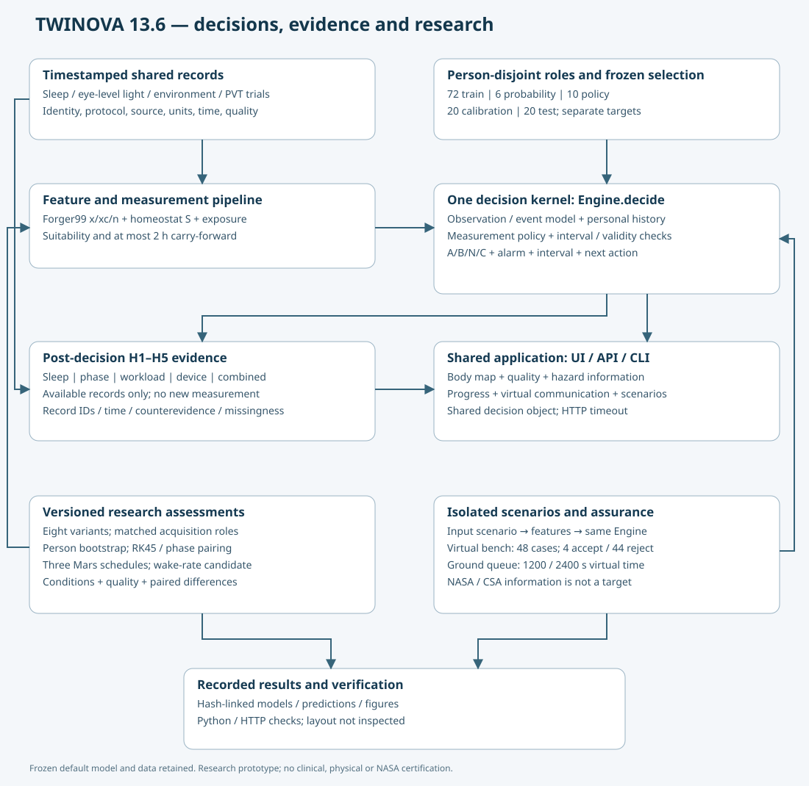

# TWINOVA

Personal sleep and attention digital twin research prototype, developed for the NASA Space Apps astronaut health-monitoring challenge.

## Quick start

Python 3.12 is recommended. From the repository root:

```sh
python -m venv .venv
# Linux/macOS
source .venv/bin/activate
# Windows PowerShell: .venv\Scripts\Activate.ps1
python -m pip install -r requirements.txt
python -m v136.release --demo
```

Open http://127.0.0.1:8765. The server binds to localhost. Stop it with Ctrl+C. No cloud account, API key, or external database is required for the bundled example.

## What the prototype does

- Computes circadian and homeostatic state from time-stamped sleep/light history.
- Predicts attention performance and a separately defined lapse event.
- Keeps before-measurement and after-measurement information boundaries explicit.
- Evaluates current measurement suitability and independent calibration evidence.
- Provides five deterministic evidence explanations, virtual hardware checks, conditional input scenarios, and Mars day-length research views.
- Uses one numerical decision engine for the interface, API, CLI, and replay experiments.

The interface and maintained documentation are English. Versioned Python module names remain because serialized models depend on their import paths.

## Reproduce checks

```sh
python -m v136.release --verify
python -m v136.release --integrity
python -m v136.cli --request '{"person":"C135-108","task":"13-16","stage":"after","lang":"en"}'
python -m v136.release --report
```

`--experiments` reruns the maintained research comparisons and overwrites their generated reports, not the frozen default model. It may take several minutes. Save any previous research results first.

## Data and model scope

The bundled integrated study is a **synthetic engineering cohort**, not astronaut or clinical participant data. It contains 128 artificial identities and 3,584 scheduled tasks. Data origin, units, model identity and availability times are preserved in manifests and responses. Archived real-data research from earlier development is not part of this maintained distribution.

Recorded experiments are retrospective. Hardware benchmarks use a discrete-event virtual rig. The AVR firmware is compiled, but the packaged evidence does not certify a physical board run. The software provides research decision support, not diagnosis, treatment, or mission clearance.

The frozen model remains unchanged. The additional wake-rate candidate was evaluated but not promoted. See [the model card](docs/MODEL_CARD.md) and [architecture](docs/ARCHITECTURE.md).

## Repository layout

| Path | Purpose |
|---|---|
| `v136/` | Current application, English service, research and evidence explanations |
| `v135/` | Shared numerical kernel, trial contract, training and replay |
| `v133/`, `v134/`, `v132/` | Required numerical, hardware and contract dependencies |
| `ui/` | English astronaut interface |
| `data_v135/`, `models_v135/` | Versioned engineering example and frozen model |
| `models_v136/`, `reports_v136/` | Research candidates and recorded results |
| `hardware_v133/` | AVR source and build support |
| `docs/` | Usage, scope, attribution and publication notes |

Only trusted local joblib artifacts should be loaded. Keep any future participant data and local ledgers out of a public repository. Review third-party terms before redistributing new sources. This repository is independent of NASA and CSA; use of their research resources is not agency endorsement.

## Optional physical capture

Install `python -m pip install -r requirements-hardware.txt` only when connecting a serial reference device. AVR compilation also requires an external AVR toolchain; it is not included in the Python environment. See [hardware documentation](docs/HARDWARE.md).

## Architecture diagram


